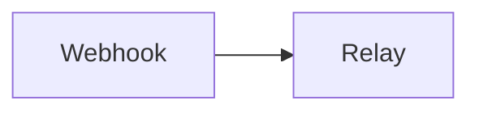

# Relay

Relay forwards webhook events to internal consumers. It listens on port 8080 by default.

## Setup

1. Install the `relay` binary.
2. Set `RELAY_TOKEN`.
3. Run `relay serve`.

## Retries

Failed deliveries are retried 3 times with a fixed 5 second delay.



<!--endmark edit e-0h5n by=adam at=2026-11-09T09:12:00Z
```replace
Install the binary.
```
```with
Install the `relay` binary.
```
-->

<!--endmark suggest s-3c7j by=maria at=2026-11-09T10:30:00Z
Two retries was the v1 behaviour.

```replace
retried twice
```
```with
retried 3 times
```
-->

<!--endmark accept s-3c7j by=adam at=2026-11-09T11:02:00Z -->

<!--endmark comment c-7f3k by=maria at=2026-11-10T14:05:00Z
```on
port 8080
```
Is this still right? Staging moved to 8443 last month.
-->

<!--endmark comment c-2m9x re=c-7f3k by=agent:claude for=adam at=2026-11-11T16:38:00Z
Confirmed against `deploy/values.yaml`. Fix proposed in s-4q8d.
-->

<!--endmark suggest s-4q8d by=agent:claude for=adam at=2026-11-11T16:40:00Z
Port changed in v2, heading renamed to match the CLI docs, diagram shows the consumer.

```replace
port 8080
```
```with
port 8443
```

```replace
## Setup
```
```with
## Installation
```

```replace
  A[Webhook] --\> B[Relay]
```
```with
  A[Webhook] --\> B[Relay] --\> C[Consumer]
```
-->

<!--endmark comment c-9d1t by=adam at=2026-11-11T17:20:00Z
```in
retried 3 times
```
```on
3
```
Should this be configurable?
-->

<!--endmark accept s-4q8d by=adam at=2026-11-11T17:40:00Z -->

<!--endmark anchor c-7f3k by=adam at=2026-11-11T17:40:00Z
```on
port 8443
```
-->

<!--endmark revert r-6w2p re=s-4q8d by=maria at=2026-11-12T09:15:00Z
The v2 rollout is postponed. Staging is back on 8080.

```replace
port 8443
```
```with
port 8080
```

```replace
## Installation
```
```with
## Setup
```

```replace
  A[Webhook] --\> B[Relay] --\> C[Consumer]
```
```with
  A[Webhook] --\> B[Relay]
```
-->

<!--endmark anchor c-7f3k by=maria at=2026-11-12T09:15:00Z
```on
port 8080
```
-->
